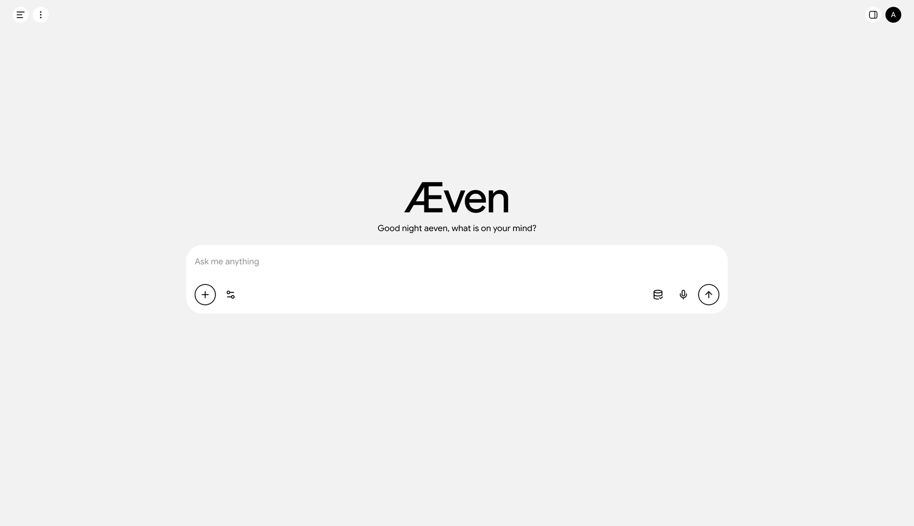

# Aeven (Æven)

[English](README.md) | 中文



## 你带来想法，Aeven 找到方法。

Aeven 是面向数字生活、开放且不依赖特定模型的 AI 操作层。它连接你的文件、应用、消息、浏览器和工具，让你从想要达成的目标出发。研究问题、制作文档、整理项目、开发软件，或让任务从一个应用延续到另一个应用。

Aeven 汇集理解任务所需的上下文与执行任务所需的能力。它记住相关工作、学习可复用流程，并将这些知识保留在模型之上的层中。你可以更换底层模型，同时保留会话、连接和积累的上下文。

**AI 能做得更多，你也可以。**

[开始使用](#run) · [文档](https://docs.aeven.io/) · [桌面应用](apps/desktop/README.zh.md) · [开发者](#open-by-design)

Aeven 处于开发者预览阶段，功能和数据格式可能发生变化。授予它文件、账户或电脑访问权限前，请阅读[安全说明](SAFETY.zh.md)。

## 目录

- [从目标出发](#start-with-the-outcome)
- [Aeven Layer](#the-aeven-layer)
- [连接你的数字世界](#connect-your-world)
- [运行](#run)
- [开放设计](#open-by-design)
- [参与贡献](#contributing)
- [社区与支持](#community-and-support)
- [许可证](#license)

-----

<a id="start-with-the-outcome"></a>

## 从目标出发

你的工作很少只存在于一个地方。一条消息提到一份文档，文档属于一个项目，而项目的文件、仓库和决策分散在早先的对话中。Aeven 可以配合使用已连接服务与本地工具，让上下文贯穿整个任务。

用自己的话告诉它想要的结果：

> “比较这些方案，核查其中的说法，并制作一份解释利弊的文档。”
>
> “找出属于这个项目的文件，并提出整理方案。”
>
> “排查这个 bug，实现修复，并运行相关测试。”
>
> “阅读项目讨论，为团队起草一份进展说明。”

Aeven 可以搜索、查看文件和附件、使用已连接应用、创建产物、运行代码，并将部分任务委派给子 agent。技能提供专门的操作指引，工具提供执行动作。在宿主支持的环境中，浏览器与电脑操作能力让它能够使用没有专门 API 集成的软件。

你可以在对话中查看工作过程、调整请求，并按当前权限策略回应审批提示。可用动作取决于已安装能力、已连接账户和你授予的访问权限。

-----

<a id="the-aeven-layer"></a>

## Aeven Layer

模型提供智能，Aeven Layer 保留让这些智能对你有用的上下文和经验。

它汇集四类知识：

- **关于你：** 偏好、相关历史、项目和你确认过的事实。
- **你的环境：** 工作区、已连接账户、文件和可用服务。
- **可用能力：** 工具、技能、连接器和执行环境。
- **工作方式：** 从已完成任务中学到的可复用流程。

长期记忆会在不同对话中召回相关上下文。后台学习器可以将已完成工作提炼为 agent 可复用的流程，包括步骤、验证和恢复方法。会话也保留各自的历史，支持恢复和分叉。

登录后，你可以在 **Settings → Memory** 中查看、纠正和遗忘记忆，并在 **Personalization** 中设置回复偏好。学习为后续工作提供上下文，每次工作的结果仍需验证。

**更换模型，保留你的 Aeven。** 模型提供方可以配置，而会话、记忆和集成由 Aeven 管理。支持的提供方与自定义端点参见[模型指南](docs/user/guide/providers.zh.md)。

-----

<a id="connect-your-world"></a>

## 连接你的数字世界

Aeven 通过[桌面应用](apps/desktop/README.zh.md)或带浏览器界面的本地服务器在你的电脑上运行。两者共享 Web UI 和本地会话状态。本地执行让 agent 能够访问你提供的文件、开发工具和服务。

在 **Settings → Connectors** 中连接 GitHub、Google Drive、日历、电子邮件和消息账户等服务。各提供方的设置和认证方式不同，部分连接需要宿主配置。**Skills** 让你导入可复用指引，自定义 MCP 连接可以提供额外工具。

你选择模型提供方以及 Aeven 可以访问的系统。本地宿主仍可能将数据发送给已配置的模型与连接器服务；提供方和权限选择决定工作会流向哪里。

开发者也可以运行一次性 headless 任务，通过 TypeScript 或 Python SDK 集成会话，并通过 ACP 连接自动化客户端。[CLI 参考](apps/cli/README.zh.md)介绍这些入口。

-----

<a id="run"></a>

## 运行

### 通过 npm 运行

安装 Node.js 22.x 系列的 22.19 或更高版本，或 Node.js 24 及以上版本，然后在项目目录中运行：

```sh
npx @aeven/cli web
```

Aeven 默认会在 `http://127.0.0.1:3080` 启动 Web UI，本机启动时会打开浏览器。通过 SSH 启动时会打印宿主机 URL；请使用 SSH 客户端或编辑器的端口转发来访问。传入 `--no-open` 可仅启动服务而不打开浏览器。

### 运行第一项任务

发送任务前，界面需要配置模型提供方并选定工作区。

1. 打开 **Settings → Providers**，添加你的模型提供方并保存凭据。默认未配置任何提供方。
2. 选择工作区，添加项目目录并选中它。
3. 在输入框中选择模型，新建会话并发送任务：

> 概述这个仓库，并指出它的主要包。

Agent 工作时，工具调用和结果会显示在对话中。当前权限策略要求审批的操作会提示你作出决定。如果提供方需要额外设置，请参见[模型配置指南](docs/user/guide/providers.zh.md)。

<a id="run-from-source"></a>

### 从源码运行

使用仓库源码来开发或定制 Aeven。请安装上述 Node.js 版本及 [package.json](package.json) 声明的 pnpm 版本。

```sh
git clone https://github.com/Aeven-AI/Aeven.git aeven
cd aeven
pnpm install
pnpm run build
pnpm avn web
```

构建会准备包和前端产物。`pnpm avn web` 会直接启动这些产物，不会重新构建。贡献者工作流程参见[开发指南](docs/development.zh.md)。

-----

<a id="open-by-design"></a>

## 开放设计

你可以自行查看、运行、修改和扩展 Aeven。它的一切皆插件设计涵盖 agent 循环、模型适配器、工具、权限、会话持久化和 UI。[Cordis](https://github.com/cordiverse/cordis) 将这些插件组合成运行中的应用。Profile 选择插件组合，配置补丁让你替换或扩展它。

例如，你可以添加工具、拦截模型请求、提供上下文、更换执行提供方，或构建读取会话事件流的客户端。默认 agent 循环本身也可以替换。因此，Aeven 既是可以直接运行的应用，也是可以针对不同 agent 工作流进行定制的框架。

- [架构](docs/architecture.zh.md) — 理解 profile、agent 循环、会话事件和扩展点。
- [插件开发](docs/user/develop/basic/index.zh.md) — 学习构建 Cordis 插件。
- [扩展实操手册](docs/cookbook/extension-cookbook.zh.md) — 找到某项能力的扩展点。
- [TypeScript SDK](packages/sdk/client/README.zh.md) 与 [Python SDK](docs/user/guide/python-sdk.zh.md) — 将 agent 会话集成到应用中。
- [开发指南](docs/development.zh.md) — 开展源码开发；编码 agent 请遵循 [AGENTS.md](AGENTS.md)。

Cordis 的设计参见论文 [_A Programming Paradigm for Spatiotemporal Composability_](https://arxiv.org/abs/2608.25512)。

<a id="contributing"></a>

## 参与贡献

Aeven 处于开发早期，目前不接受外部 pull request。在为本仓库开展贡献工作前，请先阅读 [CONTRIBUTING.md](CONTRIBUTING.zh.md)。

你可以通过 [GitHub Discussions](https://github.com/Aeven-AI/Aeven/discussions) 报告可复现的 bug、分享反馈和真实使用场景，或在本仓库之外构建技能、插件和集成。帮助用户用 Aeven 完成实际工作的指南和示例也很受欢迎。请为插件仓库添加 [`avn-plugin`](https://github.com/topics/avn-plugin) 话题，方便其他人发现它们。

<a id="community-and-support"></a>

## 社区与支持

欢迎在 [GitHub Discussions](https://github.com/Aeven-AI/Aeven/discussions) 或 [Aeven Discord 社区](https://discord.gg/6fmTDy6hYV)提问，并分享你正在构建的项目。

<a id="license"></a>

## 许可证

[Apache-2.0](LICENSE)。Aeven 所源自代码的署名见 [NOTICE](NOTICE)。依赖许可证见 [THIRD_PARTY_NOTICES.md](THIRD_PARTY_NOTICES.md)。
