# Markdown Stress Test — Heavy Fixture

A deliberate torture document for the **Aeven Web GUI** renderer. Every construct below is intentional: ATX and Setext headings, inline marks, escapes and entities, CJK/RTL/emoji width handling, links, images, deeply nested lists, wide tables, alert blockquotes, a polyglot code-block wall, Mermaid diagrams, KaTeX math, footnotes, raw HTML, sanitizer probes, and pathological tokenizer input.

Nothing here is a document. Everything here is a **test case**.

---

## 1. Headings

# H1 — Heading level one
## H2 — Heading level two
### H3 — Heading level three
#### H4 — Heading level four
##### H5 — Heading level five
###### H6 — Heading level six

####### Seven hashes is *not* a heading

Alt-H1 (Setext)
================

Alt-H2 (Setext)
----------------

### Heading with `inline code`, **bold**, *italic*, ~~strike~~, a [link](#1-headings), and 🚀 emoji
### Heading ending in closing hashes ###
#### Heading where `code_says_###` inside ticks
###### h6 & entities & <kbd>⌘</kbd>

## 2. Inline formatting

`code` · **bold** · __bold__ · *italic* · _italic_ · ***bold italic*** · ___bold italic___ · ~~strikethrough~~ · **bold with `code` inside** · *italic **nested bold** back to italic* · **bold *nested italic* back to bold**

Adjacency and punctuation: **bold**,*italic*;`code`.~~strike~~! **a**b**c** *d*e*f* _g_h_i_

Not-formatting: a*b*c, a_b_c, snake_case_word_here, 2*3*4, **unclosed bold, *unclosed italic, `unclosed code

HTML inline: <u>underline</u>, <mark>mark</mark>, <sub>H₂O sub</sub>, <sup>E=mc² sup</sup>, <kbd>⌘</kbd>+<kbd>⇧</kbd>+<kbd>K</kbd>, <abbr title="Aeven">AVN</abbr>, <small>small</small>, <s>s</s>, <del>del</del>, <ins>ins</ins>, <em>em</em>, <strong>strong</strong>, <code>html code</code>, <var>x</var>, <cite>Citation</cite>, <q>inline quote</q>, <b>b</b>, <i>i</i>, <span style="color:#e06c75">styled span</span>

Sized text: <big>big</big> <small>small</small> <sup>up</sup> <sub>down</sub>

Not-GFM extensions: ==highlight== · H~2~O · X^2^ · [[wiki link]] · #tag · @mention · :rocket: · :+1: · ++insert++ · --delete--

## 3. Escapes and entities

Backslash escapes: \` \* \_ \{ \} \[ \] \( \) \# \+ \- \. \! \| \< \> \~ \\ \& \" \' \/ \: \$ \@ \% \^ \= \, \; \? \|

Literal that must stay literal: \*not italic\* and \`not code\` and \[not a link\] and \#not-a-heading

Named entities: &amp; &lt; &gt; &quot; &apos; &nbsp;&nbsp;|&nbsp;&nbsp;gap &copy; &reg; &trade; &hellip; &mdash; &ndash; &laquo; &raquo; &sect; &para; &dagger; &Dagger; &bull; &middot; &prime; &Prime; &euro; &pound; &yen; &cent; &lambda; &pi; &Pi; &Omega; &alpha; &beta; &gamma; &Delta; &infin; &ne; &le; &ge; &plusmn; &times; &divide; &rarr; &larr; &uarr; &darr; &harr; &crarr; &hearts; &spades; &clubs; &diams; &star; &check; &cross; &phone; &email; &female; &male; &para;

Numeric entities: &#65;&#66;&#67; &#x41;&#x42;&#x43; &#x1F600; &#128640; &#960; &#8730;

Raw punctuation that must survive: < > & " ' § ¶ † ‡ • … — – « » € £ ¥ ¢ λ π Ω ± × ÷ → ← ↑ ↓ ↔

## 4. Width, unicode, and script handling

Chinese: 这是一段中文文本，用于测试中日韩宽字符的换行、断行与行高表现。标点符号，如顿号、逗号、句号，应当与文字一起正确排布。

Japanese: これは日本語のテキストです。ひらがな、カタカナ、漢字、そして全角記号！？が混在しています。レンダラーの行送りを確認する。

Korean: 이것은 한국어 텍스트입니다. 한글 자모와 받침이 섞인 문장으로 줄바꿈과 자간을 확인합니다.

العربية: هذا نصٌّ عربيٌّ لاختبار اتجاه الكتابة من اليمين إلى اليسار، والتشكيل، والأرقام ١٢٣٤٥٦٧٨٩٠.

עברית: זהו טקסט בעברית לבדיקת כיווניות, ניקוד, ומספרים 1234567890.

देवनागरी: यह हिन्दी पाठ है, जिसमें मात्राएँ, संयुक्ताक्षर और विराम चिह्न हैं।

ไทย: นี่คือข้อความภาษาไทยสำหรับทดสอบการตัดคำและการเว้นวรรค

Accents and combining marks: café naïve résumé Ångström Straße Æther fi fl Ǻ ệ ộ ǫ̃ ó o̲ o̶ ẑ ẓ ẗ ǹ

Emoji, including ZWJ sequences and flags: 😀 😃 🚀 🧪 🔥 ✅ ❌ ⚠️ 👨‍👩‍👧‍👦 👩‍💻 🧑🏽‍🚀 🏳️‍🌈 🇯🇵 🇩🇪 🇺🇸 🇺🇳 1️⃣ ©️ ®️ ™️ ⏱️ 🫠 🪐 ☕

Math-ish unicode: ∀x∈ℝ: x² ≥ 0 · ∑ᵢ₌₁ⁿ i = n(n+1)/2 · ∫₀^∞ e⁻ˣ dx = 1 · √2 ≈ 1.41421 · α→β ∧ γ∨δ · ⊂ ⊃ ⊆ ⊇ ∅ ℕ ℤ ℚ ℝ ℂ

Long unbroken token (overflow test):
aaaaaaaaaaaaaaaaaaaaaaaaaaaaaaaaaaaaaaaaaaaaaaaaaaaaaaaaaaaaaaaaaaaaaaaaaaaaaaaaaaaaaaaaaaaaaaaaaaaaaaaaaaaaaaaaaaaaaaaaaaaaaaaaaaaaaaaaaaaaaaaaaaaaaaaaaaaaaaaaaaaaaaaaaaaaaaaaaaaaaaaaaaaaaaaaaaaaaaaaaaaaaaaaaaaaaaaaaaaaaaaaaaaaaaaaaaaaaaaaaaaaaaaaaaaaaaaaaaaaaaaaaaaaaaaaaaaaaaaaaaaaaaaaaaaaaaaaaaaaaaaaaaaaaaaaaaaaaaaaaaaaaaaaaaaaaaaaaaaaaaaaaaaaaaaaaaaaaaaaaaaaaaaaaaaaaaaaaaaaaaaaaaaaaaaaaaaaaaaaaaaaaaaaaaaaaaaa

Long dotted/URL token (no break points):
`https://example.com/a/very/long/path/segment/that/keeps/going/and/going/and/going/without/any/natural/break/opportunity/at/all/really/none/whatsoever?query=aaaaaaaaaaaaaaaaaaaaaaaaaaaaaaaaaaaa&other=bbbbbbbbbbbbbbbbbbbbbbbbbbbbbbbbbbbbbb#fragment-cccccccccccccccccccccccc`

## 5. Links

- Inline: [Aeven](https://example.com/aeven)
- Inline with title: [titled link](https://example.com "Hover title text")
- Empty text: [](https://example.com)
- Reference full: [reference full][ref-full]
- Reference collapsed: [ref-collapsed][]
- Reference shortcut: [ref-shortcut]
- Reference used twice: [first][ref-full] then [again][ref-full]
- Reference with title: [titled ref][ref-titled]
- Undefined reference: [broken][no-such-reference]
- Autolink angle: <https://example.com/autolink>
- Autolink email: <nobody@example.com>
- Bare URL: https://example.com/bare
- Bare www: www.example.com
- File path-ish: `packages/core/agent-loop/src/index.ts`
- Anchor: [back to top](#markdown-stress-test--heavy-fixture)
- Pseudo-anchor that does not exist: [missing anchor](#nope)
- Mailto: [send a mail](mailto:nobody@example.com?subject=stress%20test)
- Dangerous scheme probe: [javascript: link](javascript:void(0))
- Data URL probe: [data link](data:text/plain;charset=utf-8,hello)
- Nested brackets in text: [a [b] c](https://example.com)
- Emphasis inside link text: [**bold** and `code`](https://example.com)
- Link image inside link: [](https://example.com)

## 6. Images

Data URI (offline, must render without network):


Remote images (network, lazy/loading behavior, broken-image fallback):


Image inside a link, inside emphasis, inside a list:

- [](https://example.com) *caption in italic*
- A very wide image to test max-width containment: 

## 7. Lists

Tight unordered, three levels:

- level 1 item
  - level 2 item
    - level 3 item
- second level 1 item
  * different bullet marker at level 1
    + different bullet marker at level 2

Loose unordered, separated by blank lines:

- first paragraph of item one

  second paragraph of item one

- first paragraph of item two

Ordered, custom start and continuation:

3. starts at three
4. next
5. next

1) paren delimiter
2) second
3) third

Ordered inside unordered inside ordered:

1. top
   1. nested ordered
      1. deeper ordered
         - nested unordered
           1. nested ordered again
2. second top

Deep nesting, twelve levels:

- L1
  - L2
    - L3
      - L4
        - L5
          - L6
            - L7
              - L8
                - L9
                  - L10
                    - L11
                      - L12 — the bottom of the stack

List items containing block content:

1. Item with a fenced code block:

   ```js
   const nested = true
   ```

2. Item with a blockquote:

   > Quoted inside a list item.
   >
   > Second quoted paragraph.

3. Item with a table:

   | a | b |
   |---|---|
   | 1 | 2 |

4. Item with a thematic break:

   ---

5. Item with HTML:

   <details><summary>collapsed inside a list</summary>hidden body</details>

6. Item ending with a paragraph, followed by a continuation

   and a lazy continuation line.

Interrupting a paragraph (markdown rule check):
The list below should interrupt this paragraph.
- interrupted
- and continued

1. Ordered lists interrupt differently.
2. Second.

## 8. Task lists

- [x] completed task
- [ ] incomplete task
- [x] ~~completed and struck through~~
- [ ] task with `code` and **bold**
  - [x] nested completed
  - [ ] nested incomplete
    - [ ] doubly nested
- [X] uppercase X
- [] malformed box
- [ ] task with a very long body that should wrap onto a second line without disturbing the checkbox alignment or the hanging indent of the continuation text
- [~] unsupported marker

## 9. Tables

Basic with alignment:

| Left | Center | Right | Default |
|:-----|:------:|------:|---------|
| l | c | r | d |
| longer cell here | mid | 1,234.56 | plain |
| `code` | **bold** | *italic* | ~~strike~~ |

Escaped pipe inside a cell, inline code with a pipe, and a link:

| Construct | Rendered | Notes |
|---|---|---|
| escaped pipe | `a \| b` | pipe must not split the cell |
| code with pipe | `` `x | y` `` | double-backtick span |
| link | [example](https://example.com) | with title |
| empty cell |  | intentionally empty |
| unicode | 日本語 · العربية · 🚀 | width handling |
| html | <kbd>⌘</kbd> and <mark>mark</mark> | inline html in a cell |

Wide table, twenty columns (horizontal overflow test):

| c01 | c02 | c03 | c04 | c05 | c06 | c07 | c08 | c09 | c10 | c11 | c12 | c13 | c14 | c15 | c16 | c17 | c18 | c19 | c20 |
|-----|-----|-----|-----|-----|-----|-----|-----|-----|-----|-----|-----|-----|-----|-----|-----|-----|-----|-----|-----|
| 1 | 2 | 3 | 4 | 5 | 6 | 7 | 8 | 9 | 10 | 11 | 12 | 13 | 14 | 15 | 16 | 17 | 18 | 19 | 20 |
| a | b | c | d | e | f | g | h | i | j | k | l | m | n | o | p | q | r | s | t |
| 一 | 二 | 三 | 四 | 五 | 六 | 七 | 八 | 九 | 十 | 十一 | 十二 | 十三 | 十四 | 十五 | 十六 | 十七 | 十八 | 十九 | 二十 |

Cell with long wrapped content and multi-paragraph intent:

| Field | Description |
|---|---|
| `agent-loop` | The loop drives model requests, tool dispatch, and session events. This cell is deliberately long so the renderer must wrap it across several lines while keeping the neighbouring border aligned with the row above and the row below it. |
| short | brief |

Irregular rows (fewer/more cells than the header):

| a | b | c |
|---|---|---|
| 1 | 2 |
| 1 | 2 | 3 | 4 |
| | | |

Table with only a delimiter row and no body:

| x | y |
|---|---|

## 10. Blockquotes

> Single level quote.
>
> Second paragraph in the same quote.

> Level 1
>> Level 2
>>> Level 3
>>>> Level 4
>>>>> Level 5

> Nested content inside a quote:
>
> - list item one
> - list item two
>   - nested item
>
> ```js
> const inside = 'a fenced block inside a blockquote'
> ```
>
> | a | b |
> |---|---|
> | 1 | 2 |
>
> ---
>
> Final paragraph.

> ## A heading inside a quote
> ### H3 inside a quote
> 

> Lazy continuation
that is not prefixed with a marker.

### Alerts

> [!NOTE]
> Useful information that users should know, even when skimming.

> [!TIP]
> Helpful advice for doing things better or more easily.

> [!IMPORTANT]
> Key information users need to know to achieve their goal.

> [!WARNING]
> Urgent info that needs immediate user attention to avoid problems.

> [!CAUTION]
> Advises about risks or negative outcomes of certain actions.

> [!NOTE]
> Alert containing a list:
> - one
> - two
>
> and a code span: `git rebase --abort`.

> [!UNKNOWN]
> Unrecognized alert type — must degrade to a normal blockquote.

## 11. Code blocks — polyglot wall

Plain fence with no language:

```
no language info string
  indentation preserved
	tabs	preserved	too
```

Indented code block (four spaces, no fence):

    indented code block
    second line
      deeper indent

Fence with extra info string (must not break highlighting):

```js title="app.js" showLineNumbers
const x = 1
```

Fenced block containing fences — four backticks outside, three inside:

````markdown
```js
nested fence inside a fence
```
````

Fenced block containing tilde fences:

~~~
```
~~~

Tilde fence with language:

~~~python
print("tilde fenced")
~~~

Indented code inside a list item:

1. Step one:

       deeply indented code inside an ordered list

2. Step two.

Very long single code line (horizontal scroll test):

```text
this is a single extremely long code line that should force horizontal scrolling rather than wrapping in most renderers because whitespace is preserved inside fenced code blocks and the line simply keeps going and going and going and going and going and going and going and going and going and going and going and going and going and going
```

```javascript
// JavaScript
const cache = new Map()
export async function resolve(id, { signal } = {}) {
  if (cache.has(id)) return cache.get(id)
  const res = await fetch(`/api/items/${encodeURIComponent(id)}`, { signal })
  if (!res.ok) throw new Error(`HTTP ${res.status}`)
  const data = await res.json()
  cache.set(id, data)
  return data
}
```

```typescript
// TypeScript
type Result<T, E = Error> = { ok: true; value: T } | { ok: false; error: E }

export function unwrap<T>(r: Result<T>): T {
  if (!r.ok) throw r.error
  return r.value
}
```

```tsx
// TSX
export function Badge({ label }: { label: string }) {
  return <span className="badge">{label}</span>
}
```

```python
# Python
from dataclasses import dataclass

@dataclass(frozen=True)
class Point:
    x: float
    y: float

    def norm(self) -> float:
        return (self.x ** 2 + self.y ** 2) ** 0.5

print([p.norm() for p in (Point(3, 4), Point(5, 12))])
```

```rust
// Rust
use std::collections::HashMap;

fn main() {
    let mut counts: HashMap<&str, u32> = HashMap::new();
    for word in "a b a c b a".split_whitespace() {
        *counts.entry(word).or_insert(0) += 1;
    }
    println!("{counts:?}");
}
```

```go
// Go
package main

import "fmt"

func main() {
	ch := make(chan int, 3)
	go func() { for i := 0; i < 3; i++ { ch <- i } ; close(ch) }()
	for v := range ch { fmt.Println(v) }
}
```

```java
// Java
public record User(String id, String name) {
    public static void main(String[] args) {
        var users = java.util.List.of(new User("1", "Ada"), new User("2", "Grace"));
        users.stream().map(User::name).forEach(System.out::println);
    }
}
```

```c
// C
#include <stdio.h>
int main(void) {
    for (int i = 0; i < 3; i++) printf("%d\n", i);
    return 0;
}
```

```cpp
// C++
#include <vector>
#include <algorithm>
int main() {
    std::vector<int> v{3, 1, 2};
    std::sort(v.begin(), v.end());
    return v.front();
}
```

```csharp
// C#
var squares = Enumerable.Range(1, 5).Select(n => n * n).ToArray();
Console.WriteLine(string.Join(", ", squares));
```

```ruby
# Ruby
class Greeter
  def initialize(name) = @name = name
  def call = "hello #{@name}"
end
puts Greeter.new("world").call
```

```php
<?php
$counts = array_count_values(str_split('banana'));
arsort($counts);
print_r($counts);
```

```swift
// Swift
let names = ["Ada", "Grace", "Alan"]
for (i, name) in names.enumerated() { print("\(i): \(name)") }
```

```kotlin
// Kotlin
val doubled = (1..5).map { it * 2 }.filter { it % 3 == 0 }
println(doubled)
```

```scala
// Scala
val xs = List(1, 2, 3, 4)
println(xs.foldLeft(0)(_ + _))
```

```haskell
-- Haskell
primes = sieve [2..]
  where sieve (p:xs) = p : sieve [x | x <- xs, x `mod` p /= 0]
```

```elixir
# Elixir
defmodule Greeter do
  def hello(name), do: "hello #{name}"
end
IO.puts Greeter.hello("world")
```

```erlang
%% Erlang
-module(demo).
-export([fact/1]).
fact(0) -> 1;
fact(N) -> N * fact(N - 1).
```

```clojure
;; Clojure
(defn fib [n] (take n (map first (iterate (fn [[a b]] [b (+ a b)]) [0 1]))))
(println (fib 10))
```

```sql
-- SQL
SELECT u.id, u.name, COUNT(o.id) AS orders
FROM users u
LEFT JOIN orders o ON o.user_id = u.id
WHERE u.created_at >= '2026-01-01'
GROUP BY u.id, u.name
HAVING COUNT(o.id) > 2
ORDER BY orders DESC
LIMIT 10;
```

```bash
#!/usr/bin/env bash
set -euo pipefail
for f in "$@"; do
  printf '%s: %s bytes\n' "$f" "$(wc -c < "$f")"
done
```

```zsh
# zsh
autoload -Uz zmv
zmv '(*).txt' '$1.md'
```

```powershell
# PowerShell
Get-ChildItem -Recurse -Filter *.md | Measure-Object -Property Length -Sum
```

```dockerfile
FROM node:22-alpine AS build
WORKDIR /app
COPY package.json pnpm-lock.yaml ./
RUN corepack enable && pnpm install --frozen-lockfile
COPY . .
RUN pnpm build
CMD ["node", "dist/index.js"]
```

```yaml
# YAML
name: ci
on: [push, pull_request]
jobs:
  test:
    runs-on: ubuntu-latest
    steps:
      - uses: actions/checkout@v4
      - run: pnpm install --frozen-lockfile
      - run: pnpm test
```

```json
{
  "name": "@aeven/example",
  "type": "module",
  "exports": { ".": { "types": "./lib/types/index.d.ts", "default": "./lib/index.js" } },
  "nested": { "deep": { "deeper": [1, 2, 3, null, true, "x"] } }
}
```

```toml
[package]
name = "aeven"
version = "0.1.0"
edition = "2021"

[dependencies]
serde = { version = "1", features = ["derive"] }
```

```xml
<?xml version="1.0" encoding="UTF-8"?>
<catalog><book id="1"><title>Stress</title></book></catalog>
```

```html
<!doctype html>
<html lang="en">
  <head><meta charset="utf-8" /><title>fixture</title></head>
  <body><div class="a" data-x="1">&amp; entity inside markup</div></body>
</html>
```

```css
/* CSS */
.grid {
  display: grid;
  grid-template-columns: repeat(auto-fit, minmax(12rem, 1fr));
  gap: clamp(0.5rem, 2vw, 1.5rem);
}
```

```scss
// SCSS
$brand: #4c9aff;
.button { color: $brand; &:hover { color: lighten($brand, 10%); } }
```

```graphql
# GraphQL
query Session($id: ID!) {
  session(id: $id) { id title events(first: 50) { nodes { type } } }
}
```

```proto
// Protobuf
syntax = "proto3";
message Event { string id = 1; int64 ts = 2; map<string, string> meta = 3; }
```

```hcl
# HCL / Terraform
resource "aws_instance" "web" {
  ami           = "ami-123456"
  instance_type = "t3.micro"
  tags = { Name = "web" }
}
```

```lua
-- Lua
local t = setmetatable({}, { __index = function(_, k) return k end })
print(t.anything)
```

```perl
# Perl
my %h; $h{$_}++ for split //, 'mississippi'; print "$_ => $h{$_}\n" for sort keys %h;
```

```r
# R
df <- data.frame(x = 1:5, y = c(2, 4, 6, 8, 10))
print(lm(y ~ x, data = df))
```

```julia
# Julia
f(x) = x^2 + 2x + 1
println(sum(f, 1:10))
```

```dart
// Dart
void main() => print([for (var i = 0; i < 3; i++) i * i]);
```

```objectivec
// Objective-C
NSString *s = [NSString stringWithFormat:@"%@-%d", @"id", 42];
NSLog(@"%@", s);
```

```diff
--- a/src/index.ts
+++ b/src/index.ts
@@ -1,5 +1,6 @@
-export const version = '1.0.0'
+export const version = '1.1.0'
+export const name = 'aeven'
 export default { version }
```

```ini
; INI
[section]
key = value
flag = true
```

```makefile
# Makefile
.PHONY: build
build:
	@echo building… && sleep 0.1
```

```latex
\documentclass{article}
\begin{document}
\section{Stress}\label{sec:x}
See Section~\ref{sec:x}.
\end{document}
```

```solidity
// Solidity
pragma solidity ^0.8.20;
contract Counter { uint256 public n; function inc() external { n++; } }
```

```asm
; x86-64 (AT&T)
.globl main
main:
    mov $60, %rax
    xor %rdi, %rdi
    syscall
```

```vim
" vimscript
nnoremap <leader>w :w<CR>
set expandtab shiftwidth=2
```

```text
plain text with	tab, "quotes", 'apostrophes', <angle>, & ampersand, \backslash, |pipe|, #hash, *star*
```

```unknownlanguage
unknown info string — highlighter must fall back gracefully
```

Empty fence:

```
```

## 12. Mermaid

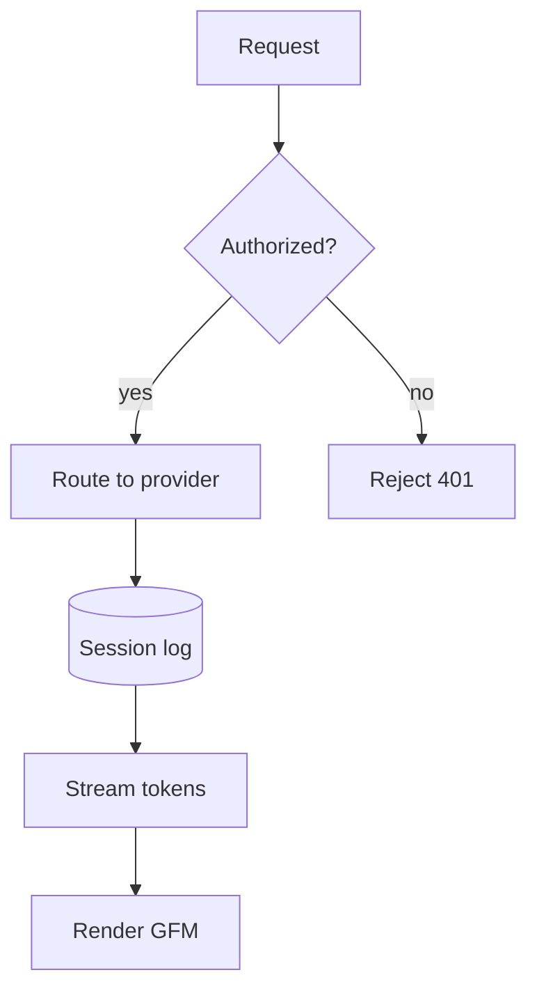

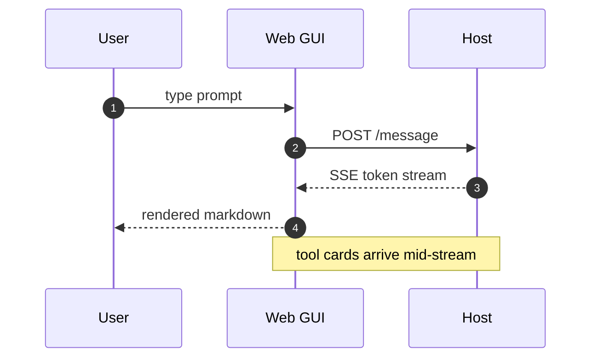

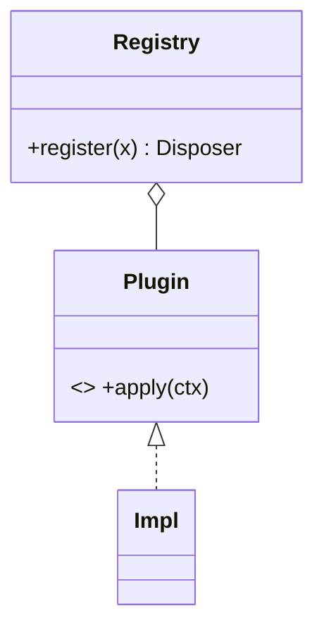

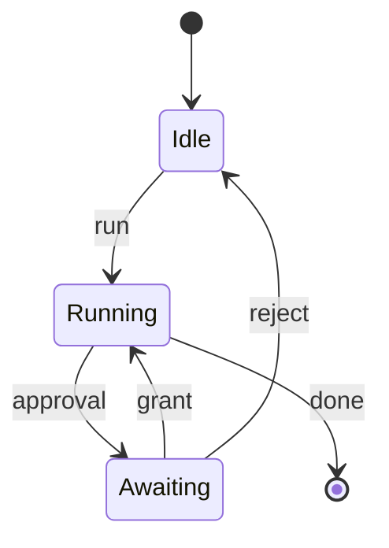

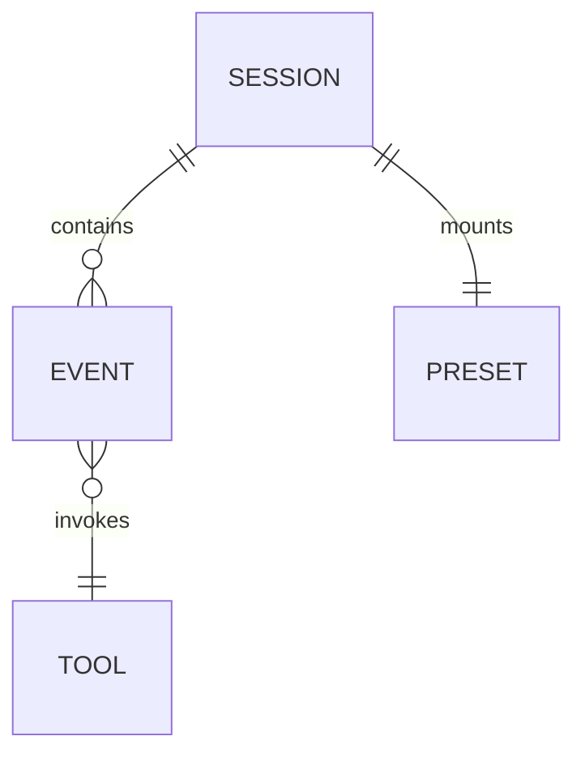

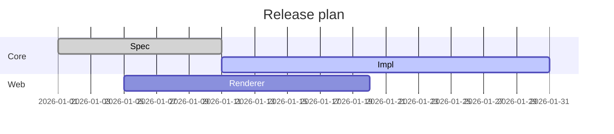

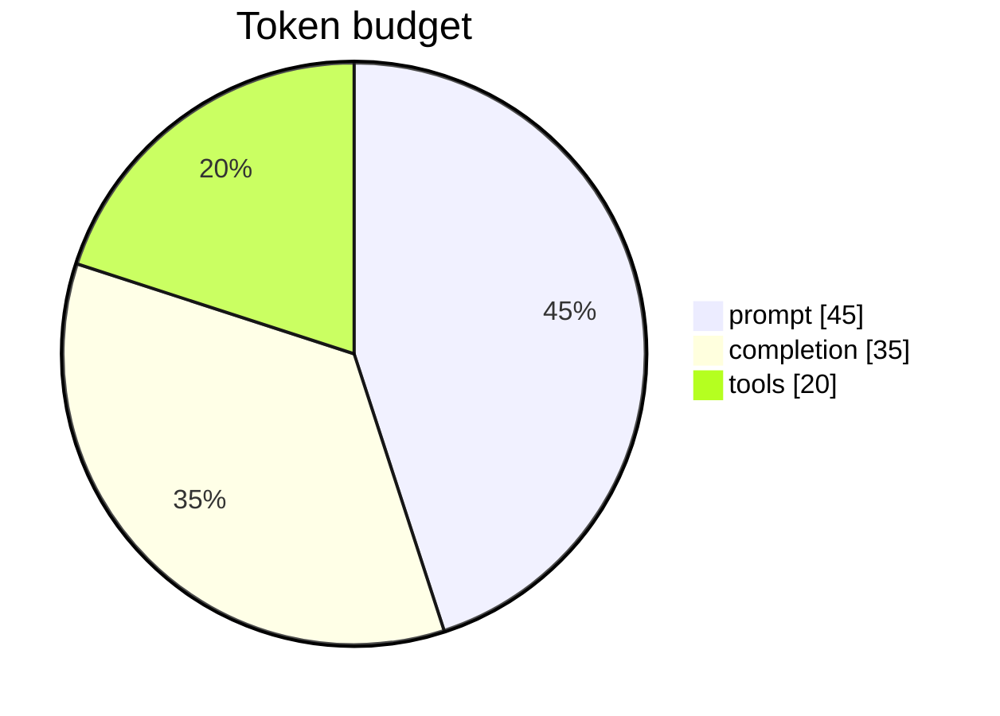

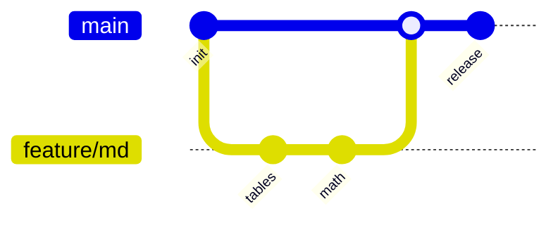

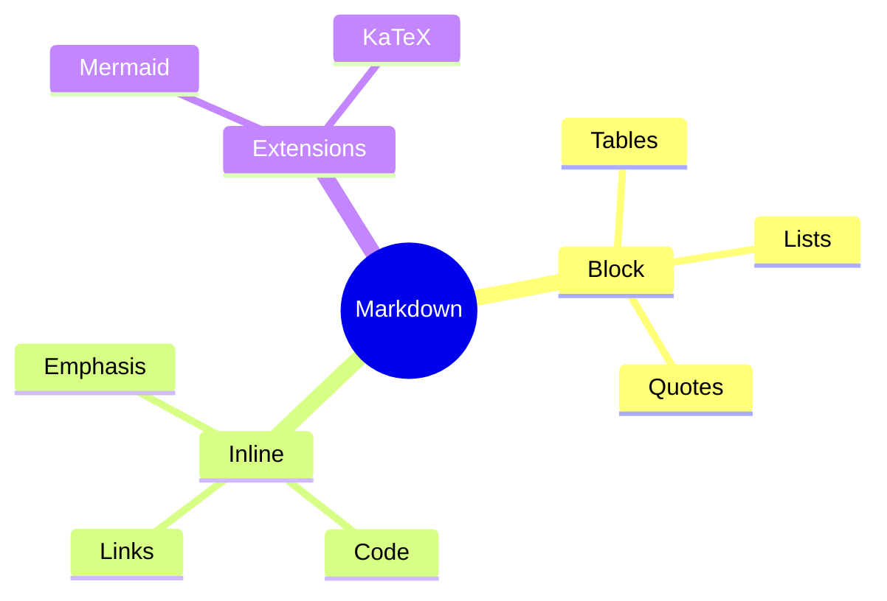

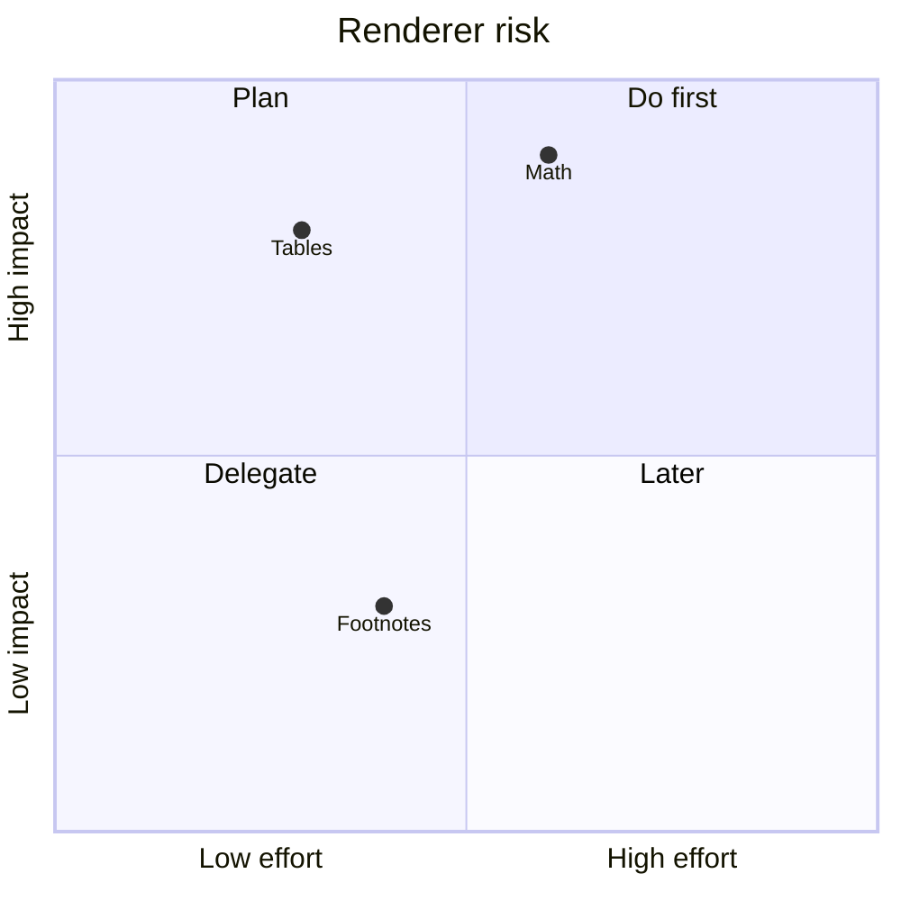

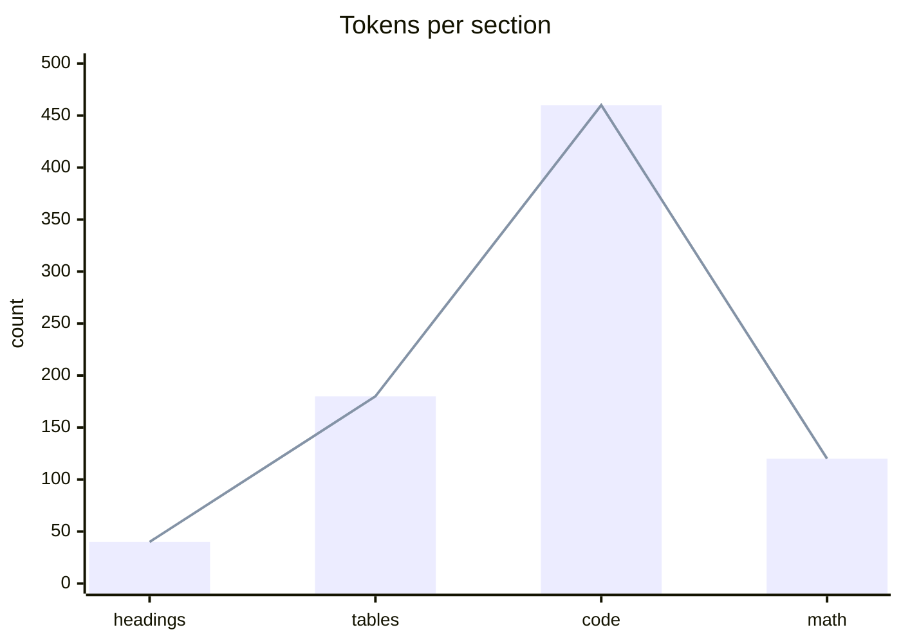

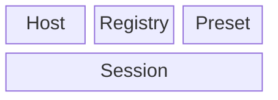

Deliberately invalid Mermaid (error handling — must not break the page):

```mermaid
flowchart TD
  A[unterminated label --> B
```

## 13. Math (KaTeX)

Inline: $E = mc^2$, $\alpha + \beta = \gamma$, $x_{i}^{2}$, $\frac{a}{b}$, $\sqrt[3]{x}$, $\sum_{i=1}^{n} i$, $\int_0^\infty e^{-x}\,dx = 1$, $\lim_{n\to\infty}\left(1+\frac1n\right)^n = e$, $\mathcal{O}(n\log n)$, $\mathbb{R}^n$, $\vec{v}\cdot\vec{w}$, $\hat{H}\psi = E\psi$

Inline with surrounding punctuation: the mass–energy relation ($E = mc^2$) is famous; so is $a^2 + b^2 = c^2$.

Display:

$$
\int_{-\infty}^{\infty} e^{-x^{2}}\,dx = \sqrt{\pi}
$$

$$
\begin{aligned}
\nabla \cdot \mathbf{E} &= \frac{\rho}{\varepsilon_0} \\
\nabla \cdot \mathbf{B} &= 0 \\
\nabla \times \mathbf{E} &= -\frac{\partial \mathbf{B}}{\partial t} \\
\nabla \times \mathbf{B} &= \mu_0\mathbf{J} + \mu_0\varepsilon_0\frac{\partial \mathbf{E}}{\partial t}
\end{aligned}
$$

Matrix and cases:

$$
A = \begin{pmatrix} a_{11} & a_{12} \\ a_{21} & a_{22} \end{pmatrix}
\qquad
f(x) = \begin{cases} x^2 & x \ge 0 \\ -x & x < 0 \end{cases}
$$

$$
\begin{bmatrix} 1 & 0 \\ 0 & 1 \end{bmatrix}
\begin{vmatrix} a & b \\ c & d \end{vmatrix}
\binom{n}{k} = \frac{n!}{k!(n-k)!}
$$

Long single formula (overflow test):

$$
\mathcal{L}\{\theta\} = \sum_{i=1}^{N} \log\!\left(\frac{\exp\!\left(\mathbf{w}_{y_i}^{\top}\mathbf{h}_i + b_{y_i}\right)}{\sum_{j=1}^{K}\exp\!\left(\mathbf{w}_{j}^{\top}\mathbf{h}_i + b_{j}\right)}\right) - \lambda \sum_{k=1}^{K}\left\|\mathbf{w}_k\right\|_2^2
$$

Math inside a list, a table, and a blockquote:

- Inline in a list: $a_n = a_1 r^{n-1}$
- Display in a list (indented):

  $$
  \sum_{k=1}^{n} k^3 = \left(\frac{n(n+1)}{2}\right)^2
  $$

| Symbol | Meaning | Value |
|:---:|:---|:---|
| $c$ | speed of light | $2.998 \times 10^8\ \mathrm{m/s}$ |
| $\hbar$ | reduced Planck | $1.054 \times 10^{-34}\ \mathrm{J\cdot s}$ |

> Quoted math: $\oint \mathbf{B}\cdot d\mathbf{l} = \mu_0 I_{\text{enc}}$

Negative cases that must NOT become math: a price of $5 and another of $10 for a total of $15. Also \$20 escaped, and `$not math$` inside code, and $$not display$$ on one line with stray dollars.

Escaped dollar: \$100. Two dollars adjacent: $$. Lone dollar at end of a line: $

## 14. Footnotes

A claim with a footnote.[^1] A second claim with a different note.[^note-b] A repeated reference to the first note.[^1] An inline footnote.^[This is an inline footnote whose text lives directly in the reference.] A footnote with rich content.[^rich] A footnote referenced before it is defined.[^later]

[^1]: Simple footnote text.
[^note-b]: Footnote with a label containing a dash.
[^rich]: Footnote containing multiple paragraphs and a list.

    Second paragraph of the rich footnote.

    - item one
    - item two

        ```js
        const insideFootnote = true
        ```
[^later]: This definition appears after the reference above it.

## 15. Thematic breaks

Above the break.

---

Between two rules.

***

___

* * *

- - -

---------------------------------------

Below the break.

## 16. Raw HTML

<details>
<summary>Native disclosure widget (click to expand)</summary>

Hidden **markdown** inside an HTML block — paragraph, list, and code:

- rendered only if the renderer re-parses inside HTML
- otherwise shown as literal text

```js
const inDetails = 'fenced block inside details'
```

</details>

<details open>
<summary>Open by default</summary>
Body text.
</details>

HTML table:

<table>
  <thead><tr><th>a</th><th>b</th></tr></thead>
  <tbody><tr><td>1</td><td>2</td></tr></tbody>
</table>

Block-level layout HTML:

<div style="border:1px solid #888;padding:8px;border-radius:6px">
  <p><strong>div</strong> with inline style, a <code>code</code> child, and <br /> a hard break.</p>
</div>

<figure>
  
  <figcaption>figure + figcaption</figcaption>
</figure>

<hr />

<!-- An HTML comment that must not be displayed -->

Sanitizer probes — each of these must be neutralized (dropped, escaped, or rendered inert), never executed:

<script>/* sanitizer probe: must not execute */</script>


<iframe src="https://example.com" title="iframe probe"></iframe>

<object data="data:text/html,probe"></object>

<svg onload="/* sanitizer probe */"><circle r="4" /></svg>

<a href="javascript:alert(1)">javascript: href probe</a>
<a href="data:text/html,probe">data: href probe</a>

<style>/* sanitizer probe: injected stylesheet */ body { outline: 4px solid red }</style>

<template><p>template content</p></template>

Unknown custom element: <avn-unknown-element data-x="1">fallback text</avn-unknown-element>

Malformed markup that must not swallow the rest of the document: <div <span> <unclosed

## 17. Reference definitions

Definitions live at the bottom of this file (out of reading order on purpose) so reference resolution is exercised: [ref-full], [ref-collapsed][], [ref-shortcut], [ref-titled].

## 18. Overflow and layout pressure

A paragraph with an em dash—like this—and a long run of non-breaking&nbsp;spaces&nbsp;between&nbsp;words&nbsp;that&nbsp;cannot&nbsp;wrap&nbsp;at&nbsp;all&nbsp;and&nbsp;must&nbsp;therefore&nbsp;overflow&nbsp;its&nbsp;container&nbsp;if&nbsp;the&nbsp;renderer&nbsp;does&nbsp;not&nbsp;handle&nbsp;it.

A paragraph with a zero-width space here: a​b, a zero-width joiner here: a‌b, and a right-to-left mark here: a‏b.

Mixed-direction line (bidi stress): English text العربية returns to English 123 numbers finish.

Very deep blockquote (fifteen levels) to test left-margin accumulation:

> L1
>> L2
>>> L3
>>>> L4
>>>>> L5
>>>>>> L6
>>>>>>> L7
>>>>>>>> L8
>>>>>>>>> L9
>>>>>>>>>> L10
>>>>>>>>>>> L11
>>>>>>>>>>>> L12
>>>>>>>>>>>>> L13
>>>>>>>>>>>>>> L14
>>>>>>>>>>>>>>> L15 — the margin is now very wide.

Wide table (already covered) plus a wide code block and a wide formula (already covered) plus a wide image (covered) complete the overflow set.

## 19. Kitchen sink — everything inside everything

> [!TIP]
> ### Alert → heading → list → table → code → math
>
> 1. First item with **bold** and `code` and a [link](#19-kitchen-sink--everything-inside-everything) and $e^{i\pi} = -1$.
>
>    | key | value |
>    |:---|---:|
>    | `renderer` | GFM + Mermaid + KaTeX |
>    | status | ✅ |
>
>    ```mermaid
>    flowchart LR
>      Q[quote] --> A[alert] --> T[table] --> C[code]
>    ```
>
>    <details><summary>html inside a list inside an alert inside a quote</summary>
>
>    nested body with ~~strike~~ and a footnote-like marker[^1]
>
>    </details>
>
> 2. Second item with a nested quote:
>
>    > deeper quote with `code`
>    >
>    > - and a list
>    >   - and a deeper list

## 20. Pathological tokenizer input

Emphasis runs that commonly break parsers:

***a*** **a** *a* ****a**** **a*** *a** a***b***c **a*b** *a**b* _a_b_ __a__b__ a_b_c_d_ **a**b**c**d ***e***f

Adjacent marks with no space: `**bold**`*italic*~~strike~~**bold**___x___

Unmatched and dangling: ** * ~~ ` *** ***

Markers at line start that are not block syntax:

- not a list
+ not a list
* not a list
1. is a list
1. again
2. out of order
10. ten
1. one

#not-a-heading (no space after hash)
>not-a-quote (no space after marker)
[not a link] (not a link)
<not a tag>
<https://example.com> (is a link)
| not | a table | without a delimiter row
---
-- (two dashes: not a rule)
*** (three asterisks: a rule)

Escaped block markers:

\# escaped heading
\> escaped quote
\- escaped list
\1. escaped ordered list

Nested brackets and parens in link text and URLs: [a [nested] label](https://example.com/path_(with_parens)/x?q=a(b)c)

Entity-looking text that must stay literal inside code: `&amp; &#65; &lt;`

## Verification checklist

| # | Check | Expected |
|---:|:---|:---|
| 1 | Headings h1–h6, Setext, and 7-hash non-heading | levels differ, no phantom heading |
| 2 | Inline marks and adjacent punctuated marks | each mark closes exactly once |
| 3 | Escapes and entities | escaped chars render literally |
| 4 | CJK / RTL / emoji / combining marks | correct shaping, wrapping, and alignment |
| 5 | Long unbroken token and long URL | contained or scrollable, never breaks layout |
| 6 | Reference links incl. undefined one | resolved ones link, undefined degrades |
| 7 | Data-URI image, remote images, broken image | first renders offline, broken degrades gracefully |
| 8 | 12-level list, list holding code/table/quote | indentation stable, blocks contained |
| 9 | Task lists incl. malformed markers | boxes render, malformed stays text |
| 10 | 20-column table and escaped pipe | horizontal scroll, cells not split |
| 11 | Alerts NOTE/TIP/IMPORTANT/WARNING/CAUTION + unknown | five styled, unknown degrades to quote |
| 12 | Polyglot code blocks incl. unknown language | highlighting or graceful plain text |
| 13 | Nested fences and tilde fences | inner fence stays literal |
| 14 | Mermaid (10 valid + 1 invalid) | valid render, invalid shows error without breaking the page |
| 15 | KaTeX inline/display/matrix/cases + non-math dollars | math renders, prices stay plain |
| 16 | Footnotes incl. rich and forward reference | markers link to definition list |
| 17 | Raw HTML incl. details/figure | rendered where allowed |
| 18 | Sanitizer probes | never execute, never render as live markup |
| 19 | Deep blockquote margin accumulation | readable, bounded |
| 20 | Kitchen sink nesting | every nested construct still renders |

---

*End of fixture. If you can read this line without the widget above being broken, the renderer survived.*

[ref-full]: https://example.com/reference-full
[ref-collapsed]: https://example.com/reference-collapsed
[ref-shortcut]: https://example.com/reference-shortcut "Shortcut reference with a title"
[ref-titled]: https://example.com/reference-titled "Titled reference"
[ref-unused]: https://example.com/never-used
